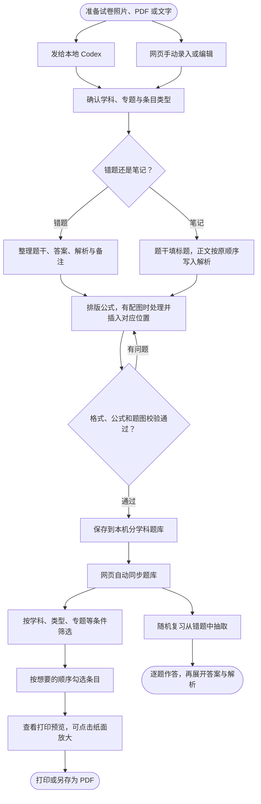

# 错题与笔记整理流程

- **录入与核查**。Codex 根据指定范围核对题干、答案和推导。数学公式使用 LaTeX，化学式使用 mhchem。整理照片时裁掉无关内容、转正并增强对比度。
- **保存与同步**。Codex 可通过录入脚本新增或更新单条、批量记录，写入后再运行题库校验。网页可点击「保存到本地」，打开的页面约每 2 秒检测题库变化。
- **回顾与打印**。错题和笔记都可以筛选、勾选和打印。打印按勾选顺序编号，可选择纸张、栏数及答案、解析、备注的显隐。随机复习可指定单科或全部学科。

[本地录入与备份步骤](LOCAL_CODEX_WORKFLOW.md) · [题目与笔记的保存格式](../QUESTION_FORMAT.md)
