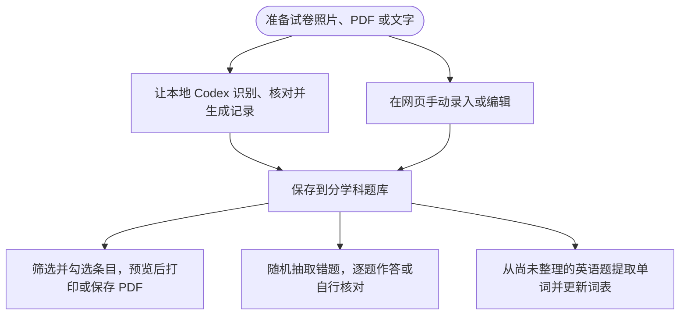

# 错题与笔记使用指南

## 录入和修改题目

1. 点击「录入新题」，选择学科、专题和条目类型。能确认卷名和题号时，在「来源」填写，例如「高三数学周练 12 第9题」。列表搜索也支持来源。
2. 错题可选文本、判断或单选。单选题在「单选题选项」填写 A–D，再选择正确选项。题干下方的「选项预览」帮助核对显示效果。判断题选择「正确」或「错误」。笔记用「题目」写标题，用「解析」存正文。
3. 用题目和解析工具栏插入公式、图像，或设置加粗、下划线和文字颜色。图片先传到「本题图片」，可裁切、旋转、微调斜角、转黑白灰度并调对比度，再从相应字段插入。点击编辑区的图片标记，可按内容区域宽度调比例。
4. 点击「保存到本地」写入题库。再次打开同一编辑页时，当前浏览器可恢复未正式保存的文字草稿。草稿恢复后，需重传尚未正式保存的新图片。若提示题目有更新，先核对新版本再保存。

试卷或笔记较多时，可将照片、PDF 或文字发给本地 Codex，说明整理范围和解析要求。Codex 会按项目格式生成记录并执行校验。详见 [Codex 录入流程](LOCAL_CODEX_WORKFLOW.md)。

## 筛选题库和批量选题

- 学科页默认显示「错题」。顶部可切到「全部」或「笔记」，并组合关键词、专题、掌握状态和上传时间。上传时间按首次录入日期计算。
- 勾选「本次打印」可选入单条。「全选当前结果」将符合当前筛选的各页记录一并选入。切换筛选时已选记录仍保留，若被隐藏，工具栏会提示数量。切换学科时清空选择。
- 「按日期选择」显示当前学科每天的上传数量，包含错题与笔记。选择一个或多个日期，可用日历箭头跨月。点击「勾选题目」后，时间筛选回到「全部时间」，所选日期的记录追加到打印队列，包含被关键词、专题等筛选隐藏的记录。
- 在手机上，通过「更多」展开批量操作，或选「打印预览与设置」打开预览。

## 复习和导出

**随机复习**。选择学科和题量后，点击「随机抽题」。判断题与单选题作答后显示正误，再点「查看答案和解析」复盘。文本题可直接展开核对。随机复习从错题中抽取，笔记可在学科页查看或打印。

**打印预览**。题目按勾选顺序编号。纸张支持 B5 与 A4，单栏与双栏均可选。答案、解析、备注可独立显示。打印笔记请勾选「解析」。点击纸面可放大当前页，使用左右两侧翻页。点击题图可单独查看。

**导出 PDF**。选中两条或更多记录时，可用「自动调整顺序」试排，或用「恢复勾选顺序」撤回。检查纸张、顺序与分页后点击「导出 PDF」，在系统打印对话框选择「保存为 PDF」或打印。

[题目与笔记的保存格式](../QUESTION_FORMAT.md) · [备份和恢复](LOCAL_CODEX_WORKFLOW.md#备份和后续开发)
